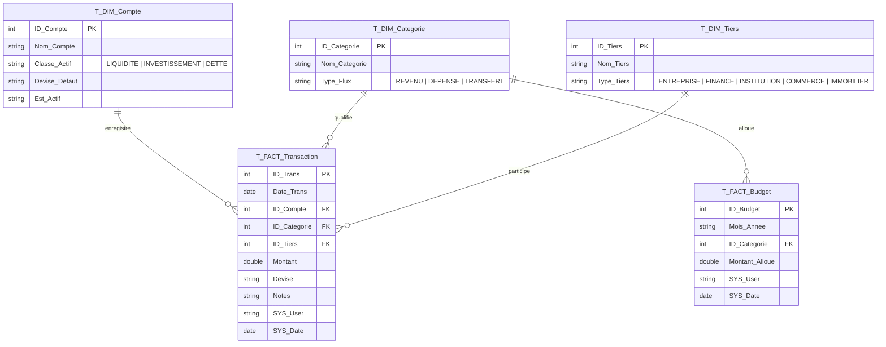

# 🏛️ GFMP — Global Finance Management Platform (SFP v1.0)
## Manuel d'Architecture Maîtresse & Spécifications Intégrales de Bout en Bout
*Wealth Management • Modélisation Kimball Star Schema • Multi-Plateforme (Excel VBA, PWA Hors-Ligne & Android Natif)*

---

## 📑 Table des Matières
1. [Vue d'Ensemble & Vision Stratégique](#1-vue-densemble--vision-stratégique)
2. [Charte Graphique Stricte & Identité Visuelle](#2-charte-graphique-stricte--identité-visuelle)
3. [Architecture des Données : Modèle Kimball Star Schema](#3-architecture-des-données--modèle-kimball-star-schema)
4. [Moteur Décisionnel Excel / VBA (Application Maîtresse)](#4-moteur-décisionnel-excel--vba-application-maîtresse)
5. [Portail Mobile Web & PWA (Local-First 100% Offline)](#5-portail-mobile-web--pwa-local-first-100-offline)
6. [Conteneur Natif Android & Pipeline de Déploiement](#6-conteneur-natif-android--pipeline-de-déploiement)
7. [Algorithme de Sécurité & Système de Licences](#7-algorithme-de-sécurité--système-de-licences)
8. [Audit de Conformité Modern Web Guidance & Bonnes Pratiques](#8-audit-de-conformité-modern-web-guidance--bonnes-pratiques)
9. [Manuel Opérationnel & Guide Développeur](#9-manuel-opérationnel--guide-développeur)

---

## 1. Vue d'Ensemble & Vision Stratégique

### 1.1 Genèse & Positionnement
**GFMP (Global Finance Management Platform)** — ou **Système Financier Personnel (SFP v1.0)** — a été conçu en février 2026 à l'Île Maurice selon les exigences les plus rigoureuses de la gestion de patrimoine (*Wealth Management Enterprise-Grade*).

La plateforme répond à trois impératifs cardinaux :
1. **Souveraineté Totale (*Local-First*)** : Zéro cloud externe, zéro dépendance réseau, zéro traçage. Les données financières restent confinées sur la machine de l'utilisateur ou son smartphone.
2. **Double Écosystème Déployable** :
   - Un environnement bureautique lourd et puissant sous **Microsoft Excel / VBA** avec base de données relationnelle en RAM.
   - Un environnement mobile tactile autonome sous **Android Natif** et **Progressive Web App (PWA)** avec moteur analytique vectorisé pur JavaScript exécutant les calculs en moins de 5 millisecondes.
3. **Pérennité & Résilience Décisionnelle** : Architecture relationnelle en étoile (*Star Schema* de Ralph Kimball), garantissant l'absence d'incohérences, la traçabilité des opérations et l'intégrité comptable.

### 1.2 Structure Globale du Répertoire

```
GFMP/
├── README.md                      # Présentation et documentation officielle GFMP
├── GFMP_V1.0.xlsm                 # Classeur maître de production Excel / VBA
├── GFMP_V1.xlsm                   # Classeur démo avec transactions exemples
├── GFMP-v1.0.apk                  # Package Android autonome racine (2.46 Mo)
├── run_mobile_preview.ps1         # Script PowerShell de serveur local Wi-Fi (Port 8089)
│
├── vba/                           # Code source VBA exporté et modulaire
│   ├── MOD_00_Architecture_v1.0.bas   # Déploiement idempotent des tables & RBAC
│   ├── MOD_01_CoreEngine_v1.0.bas     # Intégrité (Regex, Séquenceur d'ID, Anti-doublon)
│   ├── MOD_02_AppHome_Global_v1.0.bas # Hub Central (UCR, Dictionnaire i18n 8 langues)
│   ├── MOD_03_Gatekeeper_v1.0.bas     # Formulaire de saisie USF_Transaction auto-apprenant
│   ├── MOD_04_Dashboard_ETL_v1.0.bas  # Dashboard Cashflow, Time Slider, Violet Zebra
│   ├── MOD_05_Advanced_Modules_v1.0.bas # Bilan Patrimonial, Snapshot As-Of-Date, Dettes
│   ├── MOD_06_Budget_ZBB_v1.0.bas     # Pilotage Budgétaire ZBB, DataBars Jaunes
│   ├── MOD_99_SystemAdmin_v1.0.bas    # Soft/Hard Reset & Bridge Power BI
│   ├── M99_Sales_KeyGen_V1.0.bas      # Algorithme secret de génération de licences
│   ├── GFMP_v1.0.cls                  # Classe événementielle (Workbook_Open & UCR)
│   ├── USF_Transaction_V1.0.frm/.frx  # UserForm Gatekeeper
│   └── USF_Budget_V1.0.frm/.frx       # UserForm d'Allocation Budgétaire
│
├── mobile-web/                    # Application Web Mobile & Progressive Web App (PWA)
│   ├── index.html                 # Interface SPA tactile (Solid Cards, Modales, Toolbar)
│   ├── styles.css                 # Charte Haute Joaillerie, Glassmorphism & Violet Zebra
│   ├── app.js                     # Contrôleur DOM, gestionnaires d'événements & routage
│   ├── analytics-engine.js        # Moteur analytique vectorisé pur JS (Temps réel < 5ms)
│   ├── baseline_data.js           # Données Kimball initiales embarquées (window.GFMP_BASELINE)
│   ├── baseline_data.json         # Schéma de référence JSON
│   ├── manifest.json              # Manifeste PWA avec icônes maskables
│   ├── sw.js                      # Service Worker hors-ligne Cache-First
│   └── assets/                    # Identité visuelle, logos JIC et favicons
│
├── android/                       # Projet natif Android Studio (API 34 / AGP 9.0.1)
│   ├── app/
│   │   ├── build.gradle.kts       # Namespace com.jicorporate.gfmp, compileSdk 34
│   │   └── src/main/
│   │       ├── AndroidManifest.xml # Permissions réseau & configuration orientation
│   │       ├── assets/            # Réplique conforme 100% de mobile-web/
│   │       ├── kotlin/com/jicorporate/gfmp/MainActivity.kt # WebView accéléré & FileChooser
│   │       └── res/               # Thème Theme.GFMP (#4169E1) et icônes launcher
│   ├── gradle/
│   │   └── libs.versions.toml     # Définition centralisée des versions
│   ├── build.gradle.kts
│   └── settings.gradle.kts
│
├── docs/                          # Documentation et spécifications d'ingénierie
│   ├── SFP_SPEC_V1.0.docx         # Spécifications détaillées d'ingénierie
│   ├── INSTALL_ANDROID_GUIDE.md   # Guide d'installation sideloading APK & PWA
│   └── Keya-Raymond-TOP_10.pdf    # Support exécutif
│
├── licenses/                      # Outils de distribution de licences
│   ├── KeyFile.xlsm
│   └── SFP_Generateur_Licences.xlsm
│
└── dist/                          # Livrables exécutables distribuables
    └── GFMP-v1.0.apk              # Package Android signé autonome (2.46 Mo)
```

---

## 2. Charte Graphique Stricte & Identité Visuelle

L'expérience visuelle GFMP obéit à une charte chromatique "Haute Joaillerie / Royal Standard" définie dans les spécifications [SFP_SPEC_V1.0.docx](file:///c:/Users/KIMYAÉDITION/source/repos/GFMP/docs/SFP_SPEC_V1.0.docx) :

| Couleur | Code Hex | Code RGB | Utilisation Fonctionnelle |
| :--- | :--- | :--- | :--- |
| **Bleu Royal** | `#4169E1` | `RGB(65, 105, 225)` | Bandeau supérieur, bouton primaire, KPI Total Revenus |
| **Jaune Royal** | `#FADA5E` | `RGB(250, 218, 94)` | Boutons tactiles 3D, surbrillance des Dettes, DataBars ZBB |
| **Violet Royal** | `#7851A9` | `RGB(120, 81, 169)` | KPI Total Dépenses, lignes impaires Violet Zebra |
| **Violet Sombre** | `#5A3282` | `RGB(90, 50, 130)` | En-tête des tableaux Violet Zebra |
| **Violet Doux** | `#916EBE` | `RGB(145, 110, 190)` | Lignes paires des tableaux Violet Zebra |
| **Vert Émeraude** | `#10B981` / `#2ECC71` | `RGB(16, 185, 129)` | Cashflow Net positif, indicateurs de succès, toasts |
| **Rouge Alerte** | `#EF4444` / `#E74C3C` | `RGB(239, 68, 68)` | Cashflow Net négatif, dépassements budgétaires |
| **Arrière-Plan Nuit** | `#070A13` / `#090D16` | `RGB(7, 10, 19)` | Thème sombre immersif de l'application mobile |

### Règles Typographiques & Ergonomie :
- **Police Excel** : `ADLaM Display`, taille 10 verrouillée, zoom 100% forcé pour bannir toute distorsion graphique.
- **Police Web & Mobile** : `Plus Jakarta Sans` et `Inter`, avec `font-feature-settings: "tnum"` pour aligner les décimales des montants financiers.

---

## 3. Architecture des Données : Modèle Kimball Star Schema

Le socle de GFMP repose sur une séparation nette entre faits et dimensions, garantissant l'idempotence et l'intégrité relationnelle.



### 3.1 Tables de Faits (`FACT`)
- **`T_FACT_Transaction`** : Historique granulaire de tous les flux. Zéro libellé en clair (exclusivement des identifiants numériques pointant vers les dimensions), montant numérique signé, devise ISO (MUR, EUR, USD, GBP, ZAR, XOF) et horodatage d'audit.
- **`T_FACT_Budget`** : Référentiel des enveloppes budgétaires allouées par mois et par catégorie (format `AAAA-MM`), supportant la méthode **Zero-Based Budgeting (ZBB)**.

### 3.2 Tables de Dimensions (`DIM`)
- **`T_DIM_Compte`** : Classement strict des comptes par classe d'actifs :
  - `LIQUIDITE` (Compte Courant, Livret Épargne, Espèces)
  - `INVESTISSEMENT` (Assurance Vie, PEA, Cryptomonnaies)
  - `DETTE` (Prêt Immobilier, Crédit Conso, Carte Différée) — *crucial pour le calcul de la Valeur Nette*.
- **`T_DIM_Categorie`** : Typologie des flux (`REVENU`, `DEPENSE`, `TRANSFERT`).
- **`T_DIM_Tiers`** : Typologie des contreparties (`ENTREPRISE`, `FINANCE`, `COMMERCE`, etc.).

### 3.3 Tables Systèmes (`SYS`)
- **`T_SYS_Config`** : Registre clé-valeur pour l'état courant de l'application (`LANGUE_UI`, `DASH_FILTRE_ANNEE`, `DASH_FILTRE_MOIS_SEUL`, `DASH_FILTRE_DEV`, etc.) et les compteurs de séquences (`SEQ_T_FACT_Transaction`, `SEQ_T_FACT_Budget`).
- **`T_SYS_Dictionary`** : Matrice i18n $O(1)$ stockant les traductions pour 8 langues :
  - Français (`FR`), Anglais (`EN`), Espagnol (`ES`), Portugais (`PT`), Allemand (`DE`), Italien (`IT`), Néerlandais (`NL`), Suédois (`SV`).
  *(Les langues non-latines ont été écartées du cœur VBA pour éviter les risques de corruption ANSI `???` lors de la compilation Windows).*

---

## 4. Moteur Décisionnel Excel / VBA (Application Maîtresse)

L'implémentation Excel VBA est structurée dans le dossier [vba/](file:///c:/Users/KIMYAÉDITION/source/repos/GFMP/vba) en 8 modules indépendants :

### 4.1 Routage UCR (*Unique Cell Routing*) & Anti-Freeze (`GFMP_v1.0.cls` & `MOD_02`)
Dans Excel, l'utilisation de boutons traditionnels avec assignation de macros (`OnAction`) ou de liens hypertextes standards peut générer des erreurs critiques (*Erreur 400*) ou geler l'interface si un événement échoue.
- **Solution GFMP** : Les clics utilisateur sur le Hub Central sélectionnent des cellules invisibles sur la plage `A11:A24`.
- L'événement `Workbook_SheetSelectionChange` intercepte la ligne sélectionnée, replace le curseur sur `A1` et rétablit immédiatement `Application.EnableEvents = True` dans un bloc `On Error GoTo SafeExit`, rendant tout gel d'interface impossible.

### 4.2 Séquenceur d'ID Autonome & Déverrouillage Temporaire (`MOD_01`)
Plutôt que d'utiliser la fonction risquée `MAX() + 1` ou de compter les lignes d'un tableau (qui échoue lors des suppressions ou des tris), GFMP implémente `GENERER_NOUVEL_ID` :
```vba
wsSys.Unprotect "SFP_ADMIN_2026"
' Incrémentation du paramètre SEQ_NomTable dans T_SYS_Config
wsSys.Protect "SFP_ADMIN_2026", UserInterfaceOnly:=True
```
Ce mécanisme autonome garantit des clés primaires incrémentales uniques, sans jamais exposer la structure de la base aux utilisateurs.

### 4.3 Formulaire Gatekeeper Auto-Apprenant (`USF_Transaction` & `MOD_03`)
Lors de la saisie d'une transaction, si l'utilisateur choisit *"Autre (Préciser...)"* dans la liste déroulante des comptes, des catégories ou des tiers :
1. Le formulaire déploie dynamiquement des champs texte cachés.
2. L'utilisateur saisit le nouveau nom ainsi que son typage (ex: type de flux ou classe d'actif).
3. Lors de la validation, le moteur crée silencieusement la nouvelle dimension via `MOD_01`, l'injecte dans la table `T_DIM_*` correspondante, et lie directement la transaction à ce nouvel ID sans interruption de saisie.

### 4.4 Dashboards Dynamiques & Éradication du Bug 1004 (`MOD_04`, `MOD_05`, `MOD_06`)
- Chaque vue de tableau de bord est régénérée à la volée.
- **Empty State Robuste** : Lorsque aucune transaction n'existe pour le mois choisi, l'utilisation traditionnelle de `.Merge` provoque l'erreur VBA 1004. GFMP applique `CenterAcrossSelection` (Centré sur plusieurs colonnes) sans fusion physique, assurant une stabilité totale.
- **DataBars Jaune Royal** : Dans le module `MOD_06_Budget_ZBB`, la jauge de consommation budgétaire est injectée directement dans les cellules via `FormatConditions.AddDatabar` avec remplissage solide `xlDataBarFillSolid`.

### 4.5 Sécurité RBAC & Passerelle Power BI (`MOD_00` & `MOD_99`)
- Mot de passe administrateur : `"SFP_ADMIN_2026"`.
- Feuilles de base de données masquées en `xlSheetVeryHidden` : invisibles dans le menu contextuel Excel.
- `POWER_BI_ACTIVER_CONNEXION` : Procédure administrative qui passe temporairement les tables de backend en `xlSheetVisible` pour permettre au connecteur Power Query d'ingérer les tables, puis `POWER_BI_SECURISER_BACKEND` reverrouille l'étanchéité.

---

## 5. Portail Mobile Web & PWA (Local-First 100% Offline)

L'écosystème web logé dans [mobile-web/](file:///c:/Users/KIMYAÉDITION/source/repos/GFMP/mobile-web) offre une expérience mobile tactile identique aux standards des applications bancaires privées.

### 5.1 Le Moteur Analytique Vectorisé (`analytics-engine.js`)
La classe centrale `GFMPEngine` encapsule toute la logique financière en mémoire vive :
- **Temps de Réponse < 5 ms** : Les requêtes d'agrégation, de filtrage et de ventilation s'exécutent en RAM pure sans aucune requête HTTP.
- **Modèle Réactif Observer** : Enregistrement de composants écouteurs via `subscribe(listener)` et diffusion automatique via `notify()` lors de toute mutation de transaction ou de budget.
- **Calcul de Cashflow (`computeCashflow`)** : Filtrage par année et par mois (ou année entière via le code `'00'`), ventilation automatique des revenus, dépenses, calcul du cashflow net, calcul du panier moyen et regroupement par catégorie pour le graphique en beignet (*Donut Chart*).
- **Calcul de Valeur Nette As-Of-Date (`computeNetWorth`)** : Algorithme photographique cumulatif prenant en compte toutes les transactions depuis l'origine jusqu'à la date sélectionnée. Calcul séparé des Liquidités, des Investissements et mise en exergue des Dettes. Formule :
  $$\text{Valeur Nette} = \sum \text{Actifs (Liquidités + Investissements)} - \sum \text{Dettes}$$
- **Multi-Devises Instantané $O(1)$** : Table de conversion intégrée (MUR, EUR, USD, GBP, ZAR, XOF) avec recalcul immédiat des vues selon la formule :
  $$\text{Montant Converti} = \frac{\text{Montant Initial} \times \text{Taux Base de la Devise Initiale}}{\text{Taux Base de la Devise Cible}}$$
  *(Comporte également `fetchLiveExchangeRates()` pour synchroniser les cours réels lorsqu'une connexion internet est disponible, avec mise en cache locale permanente).*

### 5.2 Résilience Hors-Ligne & Contournement CORS
Sous Android WebView (`file:///android_asset/...`) ou lors de l'ouverture locale d'un fichier HTML, l'instruction `fetch('baseline_data.json')` est bloquée par les politiques de sécurité du navigateur (erreur CORS sur protocole `file://`).
- **Solution Ingénieuse de GFMP** : Les données par défaut sont également packagées dans [baseline_data.js](file:///c:/Users/KIMYAÉDITION/source/repos/GFMP/mobile-web/baseline_data.js) qui assigne directement `window.GFMP_BASELINE = { ... }`.
- L'initialisation du moteur vérifie :
  1. `localStorage.getItem('gfmp_dataset_v3')` (données sauvegardées du smartphone).
  2. Repli synchrone sur `window.GFMP_BASELINE` (données par défaut).
  3. Repli ultime sur un squelette mémoire.
L'application démarre ainsi instantanément à 100% sans aucun risque de blocage.

### 5.3 Service Worker Cache-First (`sw.js`)
Le fichier [sw.js](file:///c:/Users/KIMYAÉDITION/source/repos/GFMP/mobile-web/sw.js) enregistre le cache `gfmp-mobile-v4.0.0` et intercepte tous les événements `fetch` :
- Stratégie Cache-First : consultation immédiate du cache local pour une ouverture en 0 seconde.
- Mise à jour transparente en arrière-plan si le réseau est accessible.

---

## 6. Conteneur Natif Android & Pipeline de Déploiement

Le projet Android situé dans [android/](file:///c:/Users/KIMYAÉDITION/source/repos/GFMP/android) encapsule l'application web dans un conteneur natif APK de haute performance.

### 6.1 Toolchain & Spécifications de Compilation
- **Android Gradle Plugin (AGP)** : `9.0.1`
- **Gradle Wrapper** : `9.1`
- **Kotlin Toolchain** : `2.3.20` (JVM Target 17)
- **Compile SDK** : `34` (Android 14)
- **Target SDK** : `34`
- **Min SDK** : `24` (Android 7.0 Nougat — couvrant plus de 98% des smartphones Android en circulation).

### 6.2 Cœur Natif : `MainActivity.kt`
Le fichier [MainActivity.kt](file:///c:/Users/KIMYAÉDITION/source/repos/GFMP/android/app/src/main/kotlin/com/jicorporate/gfmp/MainActivity.kt) assure l'interface entre le matériel du smartphone et l'application web :
1. **Accélération Matérielle du WebView** : Activation de `domStorageEnabled = true`, `databaseEnabled = true`, et configuration du cache `LOAD_DEFAULT`.
2. **Sélecteur de Fichiers Natif (`onShowFileChooser`)** :
   Enregistrement du contrat moderne `ActivityResultContracts.StartActivityForResult()` pour ouvrir le gestionnaire de fichiers Android lors d'un clic sur "Restaurer une sauvegarde JSON / Importer Excel" dans l'application web.
3. **Gestion du Bouton Retour Matériel Android** :
   Utilisation de `OnBackPressedCallback` lié au `onBackPressedDispatcher` : si l'historique web interne possède des pages précédentes, `webView.goBack()` est déclenché ; sinon, l'application se ferme proprement.
4. **Chargement Hors-Ligne Embarqué** :
   `webView.loadUrl("file:///android_asset/index.html")`.

### 6.3 Parité Cryptographique des Assets
Une vérification systématique par hachage SHA-256 confirme que tous les assets de l'application web [mobile-web/](file:///c:/Users/KIMYAÉDITION/source/repos/GFMP/mobile-web) et ceux du conteneur Android [android/app/src/main/assets/](file:///c:/Users/KIMYAÉDITION/source/repos/GFMP/android/app/src/main/assets) sont **identiques à 100%**.

```
Fichier                Empreinte SHA-256 (mobile-web vs android assets)
analytics-engine.js    9D6836D2CDC3679C8140AEB8788F56... [CONFORME]
app.js                 434431BB46FC16AF59BDB22DB491E6... [CONFORME]
baseline_data.js       E3C29DFC797B70FD6C250587C887AE... [CONFORME]
baseline_data.json     417E2968A27676B3F4A276A374FCC9... [CONFORME]
index.html             A2BDCD95B6787FC0FBCFE9C64F64EE... [CONFORME]
manifest.json          64E9C9D5E0E893FE8ED87069CC48F2... [CONFORME]
styles.css             33D24F24B5D6815B0EDFCF5A6B05F7... [CONFORME]
sw.js                  2091FBD8E6D0B633DB2D858F8A6C2E... [CONFORME]
```

---

## 7. Algorithme de Sécurité & Système de Licences

Dans [vba/M99_Sales_KeyGen_V1.0.bas](file:///c:/Users/KIMYAÉDITION/source/repos/GFMP/vba/M99_Sales_KeyGen_V1.0.bas) et le classeur [licenses/SFP_Generateur_Licences.xlsm](file:///c:/Users/KIMYAÉDITION/source/repos/GFMP/licenses/SFP_Generateur_Licences.xlsm), GFMP dispose d'un algorithme déterministe d'activation de licences basé sur l'identifiant matériel de la machine (*MachineID*) :

```vba
Private Function CalculateValidKey(MachineID As String) As String
    Dim cleanID As String: cleanID = Replace(MachineID, "-", "")
    Dim i As Integer, total As Long: total = 0
    For i = 1 To Len(cleanID)
        ' Forçage Long pour éviter l'overflow
        total = total + (CLng(Asc(Mid(cleanID, i, 1))) * CLng(i) * 73&)
    Next i
    Dim p1 As String: p1 = UCase(Hex(total * 13))
    Dim p2 As String: p2 = UCase(Hex(total * 7))
    CalculateValidKey = Right("0000" & p1, 4) & "-" & Right("0000" & p2, 4)
End Function
```

### Principe Mathématique :
1. Suppression de tout tiret ou espace de l'ID machine.
2. Somme pondérée de chaque caractère ASCII multiplié par son rang $i$ et par le nombre premier $73$.
3. Calcul de deux signatures hexadécimales distinctes avec les facteurs premiers $13$ et $7$.
4. Formatage sous forme d'une clé d'activation à 8 caractères divisée en deux blocs de 4 (`XXXX-XXXX`).

---

## 8. Audit de Conformité Modern Web Guidance & Bonnes Pratiques

En consultant l'outil officiel `modern-web-guidance`, nous avons confronté l'implémentation de GFMP aux standards du Web Moderne :

### 8.1 Tableaux Responsives (`responsive-table`)
- **Implémentation GFMP** : Utilise une table sémantique avec `border-collapse: separate; border-spacing: 0;`, `position: sticky; top: 0; z-index: 2;` pour les en-têtes et `overflow-x: auto;` sur le conteneur englobant.
- **Recommandation Guidance** : Pour les écrans extrêmement étroits (< 480px), l'application d'une règle `@container (width < 600px)` transformant la table en disposition de cartes empilées avec injection des libellés de colonnes via des variables CSS (`--label-1`, `--label-2`) et pseudo-éléments `td::before` permettra une lisibilité encore plus poussée.

### 8.2 Modales & Boîtes de Dialogue (`dialog`)
- **Implémentation GFMP** : Utilise des modales immersives de type plein écran (`.modal-fullscreen`) pilotées par classes CSS et événements JavaScript. Ce choix garantit un rendu homogène et prévisible sur tous les moteurs WebView dès Android 7.0 (API 24).
- **Évolution Moderne** : Pour les cibles récentes (Android 14+ / Chrome 134+), le remplacement progressif par l'élément natif `<dialog closedby="any">` avec pseudo-élément `::backdrop` et `overscroll-behavior: contain` offrira une gestion native du focus trap sans script additionnel.

### 8.3 Ergonomie & Performance d'Interaction (`interactions-in-complex-layouts`)
- Le moteur analytique `GFMPEngine` sépare le calcul mathématique en mémoire du rendu du DOM, prévenant tout refoulement de disposition (*layout thrashing*). Les transitions d'onglets s'effectuent sans aucune saccade.

---

## 9. Manuel Opérationnel & Guide Développeur

### 9.1 Lancement de la Prévisualisation Mobile sur Réseau Local
Pour tester le portail mobile sur PC ou depuis un smartphone connecté au même réseau Wi-Fi :
```powershell
.\run_mobile_preview.ps1
```
Le script démarre un serveur Python sur le port `8089` et affiche l'adresse IP locale à ouvrir dans Chrome ou Safari Mobile (`http://<IP_LOCALE>:8089`).

### 9.2 Inspection & Compilation du Projet Android
Pour analyser le statut du projet Android via l'`android-cli` :
```powershell
android describe --project_dir=android
```
Pour compiler l'APK de débogage ou de production :
```powershell
cd android
.\gradlew assembleDebug
# L'APK généré se trouvera dans android/app/build/outputs/apk/debug/app-debug.apk
```

### 9.3 Synchronisation des Assets Web vers Android
Toute modification apportée à [mobile-web/](file:///c:/Users/KIMYAÉDITION/source/repos/GFMP/mobile-web) doit être répercutée dans [android/app/src/main/assets/](file:///c:/Users/KIMYAÉDITION/source/repos/GFMP/android/app/src/main/assets) :
```powershell
Copy-Item -Recurse -Force mobile-web/* android/app/src/main/assets/
```

### 9.4 Exploitation du Classeur Excel Maître
1. Ouvrir [GFMP_V1.0.xlsm](file:///c:/Users/KIMYAÉDITION/source/repos/GFMP/GFMP_V1.0.xlsm) avec Microsoft Excel (macros activées).
2. L'événement `Workbook_Open` initialise automatiquement l'application sur le Hub Central en mode RBAC sécurisé.
3. Mot de passe d'administration en cas de maintenance : `SFP_ADMIN_2026`.
