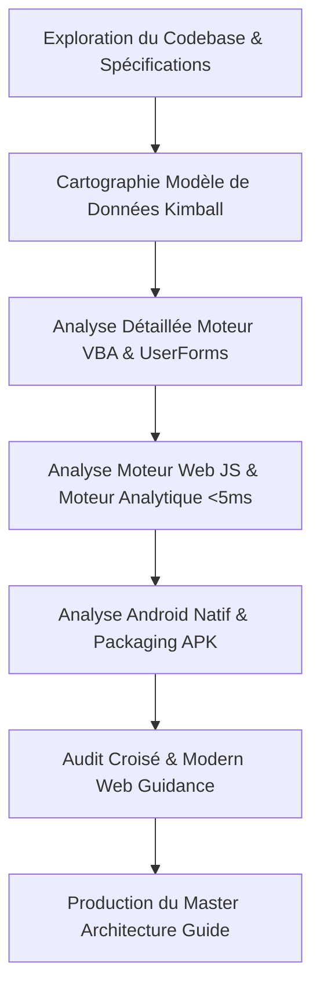

# Plan d'Apprentissage et de Cartographie Intégrale de Bout en Bout — GFMP (SFP v1.0)

## Présentation du Projet & Objectif

**GFMP (Global Finance Management Platform)** — ou **Système Financier Personnel Entreprise-Grade (SFP v1.0)** — est une solution financière locale-première (*Local-First*), souveraine et multi-plateforme conçue selon les standards de la gestion de patrimoine (*Wealth Management*).

Le projet s'articule autour de trois écosystèmes complémentaires :
1. **Écosystème Excel / VBA (Application Maîtresse)** : Moteur décisionnel en mémoire structuré selon la modélisation en étoile de Kimball (*Star Schema*), protégé par RBAC (`SFP_ADMIN_2026`) et piloté par un routeur d'événements UCR (*Unique Cell Routing*).
2. **Écosystème Mobile Web / PWA (Portail Tactile 100% Offline)** : Interface monopage responsive (charte royale Bleu/Jaune/Violet), moteur de calcul analytique vectorisé pur JavaScript (`GFMPEngine`, temps d'exécution < 5 ms), persistance `localStorage` avec repli synchrone sur `baseline_data.js`, et Service Worker Cache-First (`sw.js`).
3. **Écosystème Android Natif (Packaging & Sideloading)** : Projet Gradle 9.1 / AGP 9.0.1 (API 34 / Android 14-15) embarquant l'application web dans `app/src/main/assets/` via un `WebView` matériel accéléré avec gestionnaire de sélecteur de fichiers (`ActivityResultContracts`) et gestion matérielle du bouton retour (`OnBackPressedCallback`), distribué sous forme d'APK autonome (`GFMP-v1.0.apk`, 2.46 Mo).

L'objectif de cette mission est d'assimiler l'intégralité du projet sans zone d'ombre, d'auditer la cohérence inter-plateformes, et de délivrer une documentation architecturale maîtresse (*Master Knowledge Guide*).

---

## Revue Utilisateur Requise

> [!IMPORTANT]
> **Périmètre d'Assimilation Validé** :
> 1. **Modèle de Données Kimball** : Les 2 tables de faits (`T_FACT_Transaction`, `T_FACT_Budget`), les 3 tables de dimensions (`T_DIM_Compte`, `T_DIM_Categorie`, `T_DIM_Tiers`), et les 2 tables systèmes (`T_SYS_Config`, `T_SYS_Dictionary`).
> 2. **Moteur Métier VBA** : Modules `MOD_00` à `MOD_06`, `MOD_99_SystemAdmin`, formulaire `USF_Transaction` (Gatekeeper auto-apprenant) et `USF_Budget` (ZBB).
> 3. **Moteur JavaScript Web / PWA** : `analytics-engine.js`, `app.js`, `styles.css` (charte stricte SFP v1.0, Violet Zebra, DataBars), et `sw.js`.
> 4. **Couche Android** : Intégration WebView, synchronisation des assets, Gradle Kotlin DSL, permissions et cycle de vie.
> 5. **Algorithme de Sécurité & Clés** : Générateur de licence `M99_Sales_KeyGen` et matrice de parité machine.

> [!TIP]
> **Intégrité des Assets** : Nous avons déjà vérifié par empreinte cryptographique SHA-256 que les fichiers de `mobile-web/` et `android/app/src/main/assets/` sont synchronisés à 100%.

---

## Questions Ouvertes pour l'Utilisateur

> [!NOTE]
> 1. Souhaitez-vous, au-delà de la synthèse et de l'apprentissage de bout en bout, que nous identifiions des opportunités de refactorisation ou d'optimisation (par exemple : migration vers les API Modern Web comme `<dialog>`, View Transitions API, ou amélioration du pont de données Excel-Mobile) ?
> 2. Avez-vous une priorité spécifique sur l'un des trois piliers (VBA vs Mobile Web vs Android natif) pour de futurs développements ?

---

## Roadmap d'Assimilation & Livrables Prévus

---

### Phase 1 : Déconstruction du Modèle de Données & Moteur VBA
- **Cartographie Kimball Star Schema** :
  - `T_FACT_Transaction` (Grain : 1 transaction financière unitaire, horodatée avec devises et métadonnées système).
  - `T_FACT_Budget` (Grain : 1 enveloppe mensuelle allouée par catégorie selon la méthode Zero-Based Budgeting).
  - `T_DIM_Compte` (Comptes avec typage strict en 3 classes : `LIQUIDITE`, `INVESTISSEMENT`, `DETTE`).
  - `T_DIM_Categorie` (Flux : `REVENU`, `DEPENSE`, `TRANSFERT`).
  - `T_DIM_Tiers` (Typologie : `ENTREPRISE`, `FINANCE`, `INSTITUTION`, `COMMERCE`, `IMMOBILIER`).
- **Moteur d'Intégrité & Séquenceur** :
  - `GENERER_NOUVEL_ID` : Séquenceur autonome sans race-condition (déverrouillage temporaire de `T_SYS_Config` sans faille de protection).
  - `CLEAN_TEXT` : Nettoyage regex `\s+` et normalisation casse.
  - `EXISTE_DEJA` : Recherche RAM $O(1)$ anti-doublon.
- **Routage & UI VBA** :
  - Routage UCR (*Unique Cell Routing*) via `A11:A24` pour éviter le bug historique Excel 400.
  - Tableaux dynamiques "Violet Zebra" avec `CenterAcrossSelection` pour éliminer le bug 1004 lié aux cellules fusionnées.
  - Formulaires `USF_Transaction` (auto-apprentissage avec détection de "Autre...") et `USF_Budget` (upsert en mémoire).

---

### Phase 2 : Déconstruction du Portail Mobile-Web & Moteur Analytique
- **Moteur Analytique Vectorisé (`analytics-engine.js`)** :
  - Classe `GFMPEngine` : Architecture réactive avec pattern Observer (`subscribe`/`notify`).
  - Calcul du Cashflow mensuel et historique 6 mois (`computeCashflow`, `computeCashflowTrend`).
  - Calcul cumulatif "As of Date" de la Valeur Nette (`computeNetWorth`) avec détection immédiate des Dettes.
  - Calcul ZBB (`computeBudgetZBB`) : Taux de consommation (*burn rate*) et alertes de dépassement.
  - Multi-devises en temps réel $O(1)$ : Formule `(montant * taux_source) / taux_cible` pour MUR, EUR, USD, GBP, ZAR, XOF.
  - Fallback synchrone à 2 niveaux : `localStorage` (`gfmp_dataset_v3`) -> `window.GFMP_BASELINE` -> structure mémoire minimale (élimine tout blocage CORS sous `file:///`).
- **Contrôleur Tactile & UI (`app.js`, `styles.css`, `index.html`)** :
  - Retours haptiques via `navigator.vibrate(15)`.
  - Charte graphique Haute Joaillerie SFP v1.0 avec palette royale hexadécimale.
  - Modales pleine page immersives pour la saisie express, l'allocation budgétaire et le journal d'audit (jusqu'à 500 entrées).
  - Générateur de rapport exécutif imprimable/exportable.

---

### Phase 3 : Déconstruction du Socle Android Natif
- **Configuration Build & Toolchain** :
  - Android Gradle Plugin 9.0.1, Gradle 9.1, Kotlin 2.3.20.
  - `compileSdk = 34`, `targetSdk = 34`, `minSdk = 24`.
- **Composant d'Exécution (`MainActivity.kt`)** :
  - WebView accéléré matériellement avec `javaScriptEnabled = true`, `domStorageEnabled = true`, `allowFileAccess = true`.
  - `fileChooserLauncher` via `ActivityResultContracts.StartActivityForResult()` pour permettre l'importation de fichiers de sauvegarde JSON/Excel sur smartphone.
  - Gestion du bouton retour matériel via `OnBackPressedCallback`.
  - Chargement du bundle autonome : `file:///android_asset/index.html`.
- **Distribution Sideloading** :
  - Livrable racine et dossier de distribution `dist/GFMP-v1.0.apk` signé pour une installation directe sans compte développeur ni store.

---

### Phase 4 : Audit de Conformité & Synthèse Maîtresse
- Audit croisé Modern Web Guidance (`responsive-table`, `accessibility`, `css-layout`, `interactions-in-complex-layouts`).
- Validation des tests et builds automatisés (`android describe`, vérification d'intégrité syntaxique JS et HTML).
- Rédaction du guide de référence exhaustif dans les artefacts pour consultation permanente par l'utilisateur.

---

## Plan de Vérification

### 1. Vérification Automatisée
- **Audit de la structure Android** : Exécution de `android describe --project_dir=android` pour valider les cibles de build et la structure des variantes (`debug` / `release`).
- **Audit des empreintes de synchronisation** : Script PowerShell vérifiant la parité stricte SHA-256 entre `mobile-web/` et `android/app/src/main/assets/`.
- **Validation syntaxique des composants web** : Validation de `analytics-engine.js`, `app.js` et `index.html`.

### 2. Vérification Fonctionnelle
- Contrôle des 4 modules cardinaux :
  1. *Gatekeeper* (Saisie & Auto-apprentissage)
  2. *Cashflow Dashboard* (Time Slider, Devises, KPIs, Violet Zebra)
  3. *Bilan Patrimonial* (Snapshot "As of Date", Dettes en Jaune Royal, Valeur Nette)
  4. *Pilotage Budgétaire ZBB* (Enveloppes allouées vs réelles, DataBars, logique Upsert)
- Contrôle de la souveraineté des données (Export/Import JSON, Audit Log, 100% Hors-Ligne).
